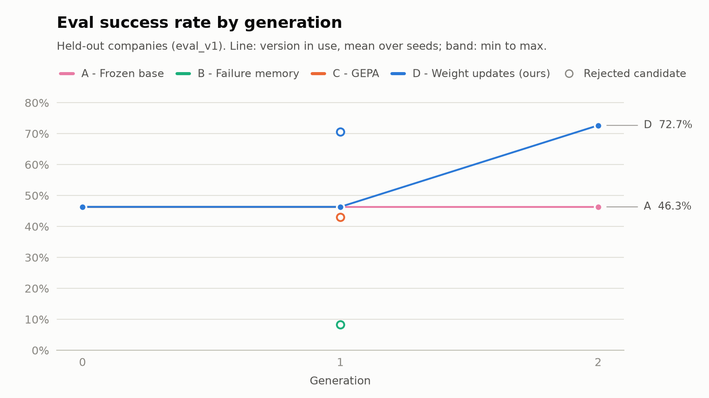

# Results

<!-- Generated by `uv run python -m scar_experiments.report` from app.generations. Do not edit by hand. -->

Eval success rate on `eval_v1` (tasks from held-out companies) of the model and prompt that are current after each generation.
A promoted candidate counts with its own score; after a rejected or failed generation the parent's score carries forward.
Generation 0 is the shared base score, and arm A (frozen base) stays at it.
Mean, min and max are over seeds; n is the number of seeds.

| Arm | Generation | Mean | Min | Max | n |
|---|---:|---:|---:|---:|---:|
| A - Frozen base | 0 | 46.3% | 46.3% | 46.3% | 1 |
| A - Frozen base | 1 | 46.3% | 46.3% | 46.3% | 1 |
| A - Frozen base | 2 | 46.3% | 46.3% | 46.3% | 1 |
| B - Failure memory | 0 | 46.3% | 46.3% | 46.3% | 1 |
| B - Failure memory | 1 | 46.3% | 46.3% | 46.3% | 1 |
| C - GEPA | 0 | 46.3% | 46.3% | 46.3% | 1 |
| C - GEPA | 1 | 46.3% | 46.3% | 46.3% | 1 |
| D - Weight updates (ours) | 0 | 46.3% | 46.3% | 46.3% | 1 |
| D - Weight updates (ours) | 1 | 46.3% | 46.3% | 46.3% | 1 |
| D - Weight updates (ours) | 2 | 72.7% | 72.7% | 72.7% | 1 |

## Every candidate the gate scored

Promotion needs a higher eval score than the parent and a regression score no more than `REGRESSION_TOLERANCE` below the parent's re-run on the same regression set (SPEC 9.9).

| Generation | Lineage | Eval | Parent eval | Regression | Parent regression | Decision |
|---:|---|---:|---:|---:|---:|---|
| 1 | B-s0 (Failure memory) | 8.3% | 46.3% | 8.1% | - | rejected |
| 1 | C-s0 (GEPA) | 43.0% | 46.3% | 90.1% | 96.7% | rejected |
| 1 | D-s0 (Weight updates (ours)) | 70.7% | 46.3% | 86.7% | 93.3% | rejected |
| 2 | D-s0 (Weight updates (ours)) | 72.7% | 46.3% | 92.7% | 88.5% | promoted |
